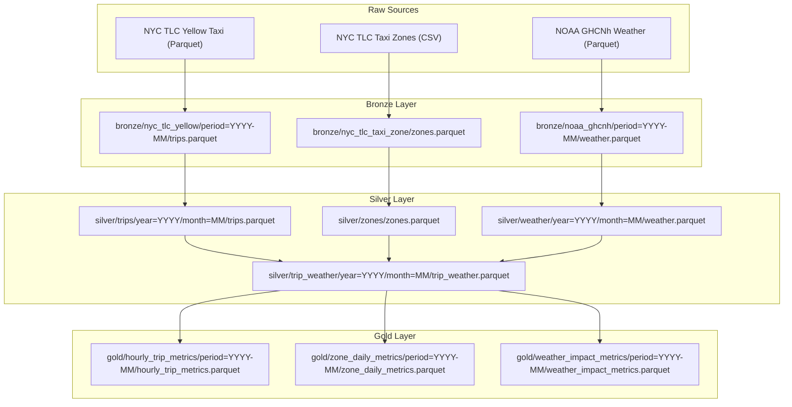

# QuantaFlow Column-Level Medallion Lineage Specification

## 1. Overview & OpenLineage Integration

QuantaFlow tracks end-to-end provenance across the entire Medallion architecture using a deterministic column-level lineage engine (`src/lineage/tracker.py`). Every pipeline execution emits a specification-compliant **OpenLineage standard JSON event** (`data/reports/openlineage_run_{run_id}.json`) capturing input datasets, output datasets, column-level derivations, and operational run metadata.



---

## 2. Layer Transformation Specifications

### 2.1 Raw $\rightarrow$ Bronze Ingestion Lineage
During raw ingestion, strict type schemas are enforced and cryptographic audit metadata is injected:

| Target Column | Source | Type | Transformation / Logic |
| :--- | :--- | :--- | :--- |
| `tpep_pickup_datetime` | `tpep_pickup_datetime` | `Datetime` | Typed cast |
| `tpep_dropoff_datetime` | `tpep_dropoff_datetime` | `Datetime` | Typed cast |
| `PULocationID` | `PULocationID` | `Int64` | Identifier typed cast |
| `DOLocationID` | `DOLocationID` | `Int64` | Identifier typed cast |
| `trip_distance` | `trip_distance` | `Float64` | Numeric typed cast |
| `passenger_count` | `passenger_count` | `Int64` | Null coalescing to `1` |
| `fare_amount` | `fare_amount` | `Float64` | Monetary typed cast |
| `total_amount` | `total_amount` | `Float64` | Monetary typed cast |
| `_ingested_at` | System Clock | `Utf8` | ISO-8601 UTC timestamp |
| `_source_file` | Source Payload | `Utf8` | Basename of ingested file |
| `_source_dataset` | Static Literal | `Utf8` | Name of raw data source |
| `_period` | Runtime Arg | `Utf8` | Target execution period (`YYYY-MM`) |

### 2.2 Bronze $\rightarrow$ Silver Transformation Lineage
In the Silver tier, domain physics rules and derived temporal features are generated:

| Silver Column | Source Column(s) | Transformation Logic |
| :--- | :--- | :--- |
| `pickup_date` | `tpep_pickup_datetime` | Date extraction: `dt.date()` |
| `pickup_hour` | `tpep_pickup_datetime` | Hourly truncation: `dt.truncate("1h")` |
| `trip_duration_seconds` | `tpep_dropoff_datetime`, `tpep_pickup_datetime` | Elapsed timestamp delta in seconds |
| `LocationID` | `LocationID` | Primary key deduplication and non-null gate |
| `pickup_borough` | `zones.Borough` | Equi-join on `PULocationID == zones.LocationID` |
| `pickup_zone` | `zones.Zone` | Equi-join on `PULocationID == zones.LocationID` |
| `precipitation` | `weather.precipitation` | Nearest hourly join on `pickup_hour == weather.timestamp` |
| `temperature_2m` | `weather.temperature_2m` | Nearest hourly join on `pickup_hour == weather.timestamp` |

### 2.3 Silver $\rightarrow$ Gold Dimensional Marts Lineage

#### Mart: `hourly_trip_metrics`
- Grouping: `pickup_hour`
- Metrics:
  - `trip_count`: `pl.count()`
  - `total_fare_revenue`: `pl.col("fare_amount").sum()`
  - `avg_fare_amount`: `pl.col("fare_amount").mean()`
  - `avg_trip_distance`: `pl.col("trip_distance").mean()`
  - `avg_trip_duration_seconds`: `pl.col("trip_duration_seconds").mean()`

#### Mart: `zone_daily_metrics`
- Grouping: `pickup_date`, `pickup_borough`, `pickup_zone`
- Metrics:
  - `trip_count`: `pl.count()`
  - `total_fare_revenue`: `pl.col("fare_amount").sum()`
  - `avg_fare_amount`: `pl.col("fare_amount").mean()`
  - `total_distance`: `pl.col("trip_distance").sum()`

#### Mart: `weather_impact_metrics`
- Grouping: `pickup_date`, `has_precipitation`, `temp_bracket`
- Metrics:
  - `trip_count`: `pl.count()`
  - `total_fare_revenue`: `pl.col("fare_amount").sum()`
  - `avg_fare_amount`: `pl.col("fare_amount").mean()`
  - `avg_trip_distance`: `pl.col("trip_distance").mean()`

---

## 3. Programmatic Lineage Extraction

To inspect or generate lineage artifacts programmatically:

```python
from src.lineage.tracker import LineageGraph

graph = LineageGraph()
artifact_path = graph.export_openlineage_event(
    run_id="run-202401-01",
    period="2024-01",
    output_dir=Path("data/reports"),
)
print(f"OpenLineage event generated at: {artifact_path}")
```
